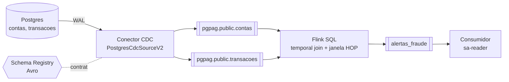

# pipeline-pagamentos-confluent
#
Pipeline de pagamentos em tempo real, do banco ao alerta de fraude, rodando no Confluent Cloud.

Os dados nascem em um **Postgres**, entram no Kafka por **CDC (Debezium)**, passam pelo **Flink SQL**, que enriquece cada transação com os dados da conta e aplica uma regra de fraude, e terminam em um tópico de alertas.

> **Regra de fraude:** 3 ou mais transações no mesmo cartão em 60 segundos geram um alerta.

## Arquitetura



## Estrutura do repositório

```
.
├── README.md
├── .env.example            # modelo das variáveis (o .env real fica fora do Git)
├── .gitignore
├── infra/
│   ├── setup.sh            # ambiente, cluster, identidades, compute pool, conector
│   └── teardown.sh         # derruba tudo
├── postgres/
│   ├── 01-schema.sql       # tabelas, publication, replica identity
│   ├── 02-seed.sql         # dados sintéticos
│   ├── 03-simular-cdc.sql  # insert, update, delete
│   ├── 04-simular-fraude.sql
│   └── 05-monitorar-slot.sql
├── schemas/
│   ├── transacao-v1.avsc
│   ├── transacao-v2-compativel.avsc
│   ├── transacao-v3-incompativel.avsc
│   └── testar-compatibilidade.sh
├── connector/
│   └── postgres-cdc-source.json.tpl
├── flink/
│   ├── 00-inspecao.sql
│   ├── 01-preparar-fontes.sql
│   ├── 02-enriquecimento.sql
│   ├── 03-regra-fraude.sql
│   └── 04-consultar-alertas.sql
└── docs/evidencias/        # prints e saídas citados abaixo
```

## Pré-requisitos

- Conta no Confluent Cloud, com [`confluent` CLI](https://docs.confluent.io/confluent-cli/current/install.html) logado (`confluent login`)
- `jq` e `envsubst` instalados
- Um Postgres **acessível pela internet** com `wal_level = logical` (o conector gerenciado precisa alcançá-lo)
- `psql` para rodar os scripts em `postgres/`

## Como subir do zero

```bash
git clone https://github.com/<seu-usuario>/pipeline-pagamentos-confluent.git
cd pipeline-pagamentos-confluent

cp .env.example .env            # preencha com seus valores (o .env NÃO vai para o Git)

# 1. Postgres de origem
psql "host=$PG_HOST dbname=$PG_DB user=$PG_USER" -f postgres/01-schema.sql
psql "host=$PG_HOST dbname=$PG_DB user=$PG_USER" -f postgres/02-seed.sql

# 2. Confluent Cloud: ambiente, cluster, identidades, Flink e conector
./infra/setup.sh

# 3. Contrato
./schemas/testar-compatibilidade.sh

# 4. Flink SQL: rode os arquivos de flink/ em ordem, no workspace SQL do Confluent Cloud
```

## Como derrubar tudo

```bash
./infra/teardown.sh
# e no Postgres, depois de remover o conector:
# SELECT pg_drop_replication_slot('pgpag_slot');
```

> O slot de replicação segura o WAL enquanto o conector não confirma a leitura. Conector parado ou removido sem apagar o slot = disco do banco enchendo.

---

## Camada 1 · Fundação

**O que faz:** cria o ambiente (com Stream Governance, que traz o Schema Registry), o cluster Kafka e duas identidades de serviço: `sa-pagamentos-writer` (escreve, usada pelo conector) e `sa-pagamentos-reader` (só lê os alertas). Cada uma recebe apenas as ACLs de que precisa.

**Por que assim:** separar quem escreve de quem lê limita o estrago se uma credencial vazar. Cluster `basic` basta para o volume do desafio e custa menos.

**Evidência:**

```
< evidência : saída de `confluent environment list`, `confluent kafka cluster list` e `confluent iam service-account list`>
```


## Camada 2 · Contrato

**O que faz:** o formato das mensagens fica registrado no Schema Registry em Avro. O script `schemas/testar-compatibilidade.sh` registra a v1, ativa o modo `BACKWARD` e testa duas mudanças: adicionar um campo **opcional com default** (compatível) e adicionar um campo **obrigatório sem default** (incompatível).

**Por que assim:** Avro com Schema Registry dá ao banco legado um contrato versionado sem escrever código (o converter faz isso). O teste de compatibilidade prova que o contrato barra mudanças que quebrariam consumidores.

**Evidência:**

```
< evidência : saída do testar-compatibilidade.sh, com is_compatible=true para a v2 e is_compatible=false para a v3>
```

## Camada 3 · Ingestão (CDC)

**O que faz:** o conector `PostgresCdcSourceV2` lê o WAL do Postgres e publica um tópico por tabela (`pgpag.public.contas`, `pgpag.public.transacoes`). Cada evento traz `op` (`c`, `u`, `d`, `r`), `before` e `after`. A chave do registro é a chave primária, o que garante ordem por linha dentro da partição.

**Por que assim:** CDC lê o log de transações, então captura `DELETE` e estados intermediários que polling perde, e não adiciona carga nem mudança de schema como triggers. `decimal.handling.mode=precise` evita que `valor` vire ponto flutuante e distorça somas.

**Evidência:**

```
< evidência : evento op=c (insert) do tópico pgpag.public.transacoes>
< evidência : evento op=u (update), com before e after>
< evidência : evento op=d (delete)>
< evidência : status RUNNING do conector>
```

## Camada 4 · Processamento (Flink SQL)

**O que faz:**

1. `02-enriquecimento.sql`: *temporal join* entre transações e contas. Cada transação enxerga a versão da conta vigente no instante em que ocorreu.
2. `03-regra-fraude.sql`: janela deslizante (`HOP`, 60 s de largura, passo de 10 s) agrupando por cartão. Se `COUNT(*) >= 3`, gera linha em `alertas_fraude`.

**Por que assim:** join, janela e estado não cabem em SMT (que vê uma mensagem por vez); isso é trabalho do Flink. A janela deslizante evita perder um padrão que cruze a borda de uma janela fixa de 60 s.

**Evidência:**

```
< evidência : SELECT * FROM transacoes_enriquecidas LIMIT 5>
< evidência : rodar postgres/04-simular-fraude.sql e mostrar SELECT * FROM alertas_fraude com o cartão card-FRAUDE>
```

## Camada 5 · Operação

**O que foi observado:** métricas do cluster e do conector (throughput, lag), quem tem acesso a quê e quanto custou.

**Evidência:**

```
< evidência : print das métricas do cluster/conector>
< evidência : ACLs ou role bindings listados>
< evidência : saída de postgres/05-monitorar-slot.sql com o wal_retido do slot>
```

## Quanto custou rodar

| Recurso | Tempo ligado | Custo |
|---|---|---|
| Cluster Kafka (basic) | `< evidência aqui>` | `< evidência aqui>` |
| Conector CDC (1 task) | `< evidência aqui>` | `< evidência aqui>` |
| Flink (compute pool) | `< evidência aqui>` | `< evidência aqui>` |
| Schema Registry | `< evidência aqui>` | `< evidência aqui>` |
| **Total** | | `< evidência aqui>` |

Fonte: tela *Billing & payment* do Confluent Cloud, anexada em `docs/evidencias/custo.png`.

## Decisões e aprendizados

- **Por que CDC e não batch/polling:** captura `DELETE`, preserva a ordem do commit e não mexe no legado.
- **Evento de banco não é evento de negócio:** `transacoes` com `op=c` é um fato técnico; um `PagamentoConfirmado` exigiria modelagem de domínio por cima.
- **At-least-once:** qualquer consumidor dos alertas pode receber repetição. Um sink para banco ou storage precisa de upsert por chave.
- **Slot de replicação:** monitorado e apagado no teardown.

## Evoluções possíveis

- Segunda regra de fraude, com outra janela e outro critério
- Dead Letter Topic (`errors.tolerance=all` + headers de contexto) em vez de deixar o conector parar
- Materializar os tópicos como tabelas Iceberg com Tableflow
# pipeline-pagamentos-confluent
# pipeline-pagamentos-confluent
